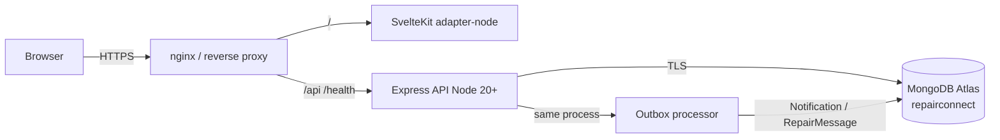

# RepairConnect — Production Deployment & Release Readiness

**Audit date:** 2026-11-09  
**Scope:** Financial consistency, transactional outbox notifications, security, database reliability, deployment architecture, full regression.  
**Live deploy:** **Not performed** (hosting architecture confirmed as Node VPS intent only; target host not smoke-tested with HTTPS).

---

## Final decision: **NO-GO** for production cutover

Application-level gates for finance, notifications, multi-tenant ACL, builds, Atlas concurrent payments, backup smoke, and Playwright lifecycle/dual-approval are **PASS**.

Production cutover remains **NO-GO** until:

1. A real Node VPS / equivalent host is confirmed and exercised with HTTPS + Secure cookies.
2. Atlas demo `@repairconnect.local` accounts are rotated or removed.
3. Atlas Cloud Backup is enabled and a restore drill is signed off (logical `mongodump` tools were not present on the audit machine).
4. Dependency advisories (notably Zod high in runtime graph) are triaged under change control.

Do **not** interpret this document as permission to deploy.

---

## 1. Production architecture



| Layer | Choice | Notes |
|-------|--------|-------|
| Frontend | `@sveltejs/adapter-node` | Selected from intended hosting: Node VPS/VM behind nginx (`DEPLOYMENT.md`). |
| API | Express on Node 20+ | Cookie JWT + CSRF; `trust proxy` for TLS termination. |
| Database | MongoDB Atlas | Transactions required for payments / outbox; `dbMode: atlas` on `/health`. |
| Notifications | Single outbox → existing Notification / RepairMessage | No second notification system. |

Same-origin reverse proxy (`/api` → API) is preferred so cookies stay `SameSite=Lax` without cross-site `None`.

---

## 2. Deployment instructions

See **`DEPLOYMENT.md`** (authoritative runbook). Summary:

```bash
# API host
npm install
npm run build -w server
NODE_ENV=production npm run start -w server
# Health: GET /health → dbMode: "atlas"

# Web host (adapter-node output)
npm install
# optional: VITE_API_URL=https://api.example.com  (omit when same-origin proxy)
npm run build -w client
node client/build/index.js
```

**Before any deploy:** confirm production secrets, `CLIENT_URL`, Atlas IP allowlist, TLS certs, and cookie `Secure` on HTTPS. This audit did **not** run those steps on a live host.

---

## 3. Environment variable documentation

| Variable | Surface | Required in prod | Notes |
|----------|---------|------------------|-------|
| `NODE_ENV` | API | yes | `production` |
| `MONGODB_URI` | API | yes | Atlas URI; missing → fatal |
| `USE_MEMORY_DB` | API | must be false/unset | `true` → fatal in prod |
| `JWT_SECRET` | API | yes | ≥ 32 chars |
| `CLIENT_URL` | API | yes | Exact frontend origin (CORS + cookies) |
| `CLIENT_URL_ALT` | API | optional | Extra CORS origin |
| `PORT` | API | optional | Default `5000` |
| `SEED_ON_START` | API | must be false/unset | `true` → fatal |
| `ALLOW_DEMO_LOGIN` | API | must be false/unset | `true` → fatal; demo emails blocked in prod |
| `COOKIE_SAME_SITE` | API | optional | Default `lax`; use `none` only for cross-site + HTTPS |
| `COOKIE_DOMAIN` | API | optional | Shared parent domain if needed |
| `ACCESS_TOKEN_TTL_SEC` | API | optional | Default `7200` |
| `REFRESH_TOKEN_TTL_SEC` | API | optional | Default `604800` |
| `PROVISIONING_API_KEY` | API | ops only | Shop provisioning / platform bootstrap |
| `VITE_API_URL` | Client build | optional | Absolute API origin if split hosts |

Never put `JWT_SECRET`, `MONGODB_URI`, or `PROVISIONING_API_KEY` in `VITE_*` variables. Client production bundle scan during this audit: **no secret strings found**.

Template: root `.env.example`.

---

## 4. Database backup / restore

Authoritative procedure: **`docs/BACKUP_RESTORE.md`**.

| Check | Result |
|-------|--------|
| Atlas connection (`dbMode: atlas`) | **PASS** |
| Non-destructive backup/restore smoke (`verifyBackupRestoreSmoke.ts`) | **PASS** (mongoose export/import round-trip) |
| Local `mongodump` / `mongorestore` | **Not installed** on audit machine |
| Atlas Cloud Backup | **Required for production** — enable in Atlas UI; quarterly restore drill |

---

## 5. Security audit results

| Control | Status | Evidence / notes |
|---------|--------|------------------|
| HTTPS / Secure cookies | **Code ready; host unverified** | `Secure` when `NODE_ENV=production` or `SameSite=None`; needs live HTTPS confirm |
| HttpOnly access/refresh | **PASS** | `rc_access`, `rc_refresh`; JWT not in JSON outside test |
| SameSite CSRF double-submit | **PASS** | `rc_csrf` + `X-CSRF-Token`; Vitest cookie-auth |
| JWT access/refresh lifecycle | **PASS** | Configurable TTL; refresh + logout covered |
| Password hashing / reset | **PASS** | bcrypt; forgot-password rate-limited |
| Login rate limiting | **PASS** | 30 / 15m; **not** disabled for E2E (`DISABLE_AUTH_RATE_LIMIT` removed from Playwright webServer) |
| CORS | **PASS** | Credentialed allowlist via `CLIENT_URL` (+ alt) |
| Request validation | **PASS** | Zod on mutating routes |
| Authorization / tenant isolation | **PASS** | Shop membership checks; lifecycle E2E customer close/pay 403; Atlas cross-shop reversal 403 |
| Secrets / env guards | **PASS** | Prod fatals for weak JWT, memory DB, seed-on-start, demo login; `CLIENT_URL` required in prod |
| Security headers / CSP | **PASS (build)** | Helmet on API; SvelteKit `kit.csp` on prod build — live header check pending |
| Dependency vulnerabilities | **RISK** | Runtime omit-dev: 11 (7 low, 3 moderate, **1 high** Zod). Full tree: 18 incl. **2 critical** (tinypool via Vitest — dev). No silent `--force` upgrade performed |

Prior detail: `docs/SECURITY_VERIFICATION.md` (still accurate on cookie/CSP model; test counts superseded below).

---

## 6. Financial consistency & notifications

### Financial

| Control | Status |
|---------|--------|
| `financialRevision` optimistic lock on payment / reversal | **PASS** |
| `finalCost` immutable after set (`FINAL_COST_LOCKED`) | **PASS** |
| Payment/reversal MongoDB transactions | **PASS** (Atlas concurrent script) |
| Immutable payment / receipt snapshots | **PASS** |
| No silent change to approved billed amount | **PASS** |
| Concurrent overpay prevented | **PASS** |
| Partial / full reversal + idempotency | **PASS** |
| Cross-shop reversal forbidden | **PASS** |

### Notifications (transactional outbox)

| Requirement | Status |
|-------------|--------|
| Never lose committed event | **PASS** — enqueue in same txn as business commit |
| Retry failed deliveries | **PASS** — backoff via `nextAttemptAt` |
| No duplicate customer-visible messages | **PASS** — unique `dedupeKey` |
| Ordering where required | **PASS** — `orderingKey` + `sequence` |
| Auditability | **PASS** — `OutboxEvent` statuses + timestamps |
| Single notification system | **PASS** — delivers into existing Notification / RepairMessage only |

---

## 7. Test results (executed this audit)

| Suite | Result |
|-------|--------|
| Backend Vitest | **88/88 PASS** (17 files) |
| Atlas concurrent payments (`verifyAtomicPaymentsAtlas.ts`) | **PASS** (overpay, partials, reversal, idempotency, cross-shop) |
| Backup/restore smoke | **PASS** |
| Playwright dual-approval (2) | **PASS** |
| Playwright lifecycle comms + payments (1) | **PASS** (rate limits left enabled) |
| Cross-tenant (customer close/pay; cross-shop reverse) | **PASS** (E2E + Atlas) |
| Client production build (`adapter-node`) | **PASS** |
| Server TypeScript build (`tsc`) | **PASS** |
| Client bundle secret scan | **PASS** (no JWT/Mongo/provisioning secrets) |

Auth rate limits were **not** disabled to make tests pass. E2E specs reuse sessions/CSRF; Playwright config no longer sets `DISABLE_AUTH_RATE_LIMIT`.

---

## 8. Remaining risks

1. **No live production/staging host verification** — HTTPS `Set-Cookie; Secure`, CSP in browser, and reverse-proxy cookie path unproven.
2. **Demo seed users** may still exist on Atlas — must rotate/disable before public URL.
3. **npm audit** — Zod high (runtime); tinypool critical (Vitest/dev). Triage with non-breaking upgrades where possible; avoid blind `npm audit fix --force`.
4. **Atlas Cloud Backup** not verified as enabled; local Database Tools missing on audit laptop.
5. **Swagger** (`/api/docs`) exposure should be restricted or authenticated on public internet.
6. **NVDA** real screen-reader session still pending (`docs/NVDA_TEST_CHECKLIST.md`).
7. **Outbox processor** runs in-process — multi-instance deploys need a single leader or lease to avoid duplicate claim races (dedupeKey mitigates customer-visible dupes; still prefer one active worker).

---

## 9. Related documents

- `DEPLOYMENT.md` — host runbook, nginx sketches, post-deploy smoke
- `docs/BACKUP_RESTORE.md` — Atlas + logical dump/restore
- `docs/SECURITY_VERIFICATION.md` — cookie/CSRF/CSP verification log
- `.env.example` — variable template

---

## Change summary from this audit (blockers only)

- Transactional **OutboxEvent** + processor wired through existing notify / repair-message paths.
- **financialRevision** bump + immutable **finalCost** on repair completion.
- SvelteKit **`adapter-node`** selected for documented Node VPS intent.
- Playwright **rate-limit bypass removed**; lifecycle/dual-approval reuse sessions.
- Backup/restore docs + non-destructive Atlas smoke script.
